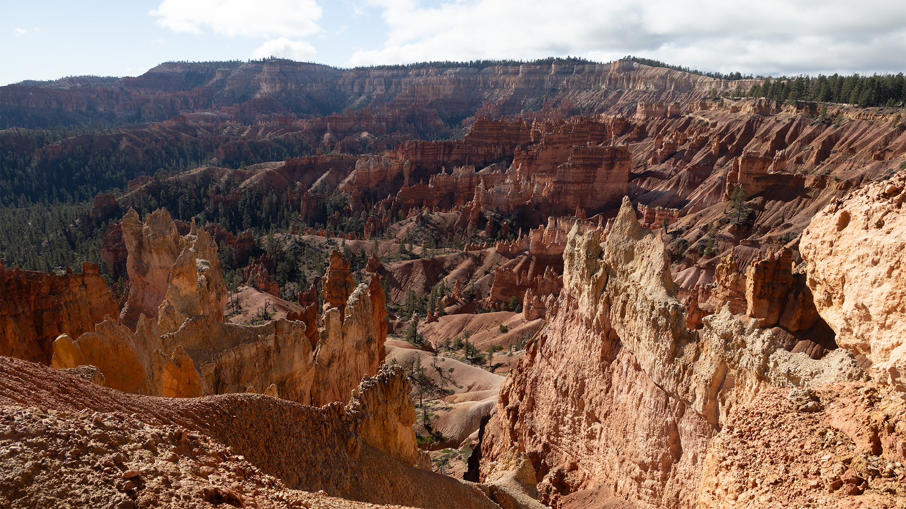
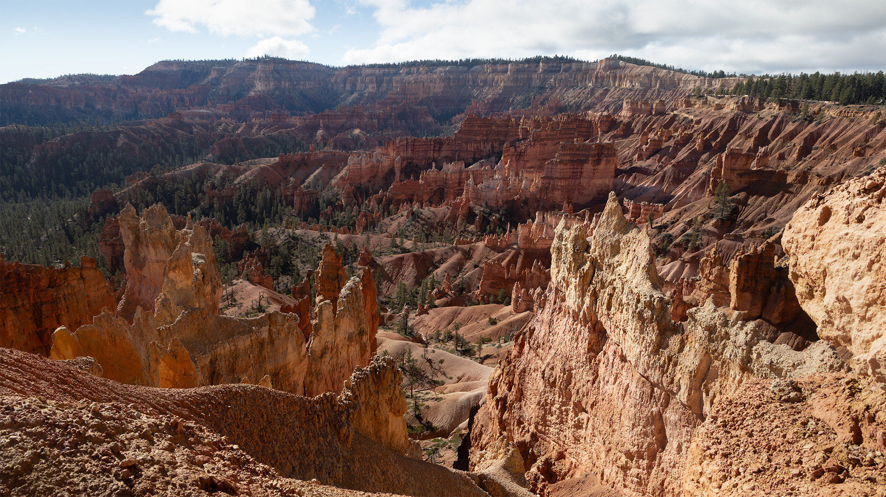
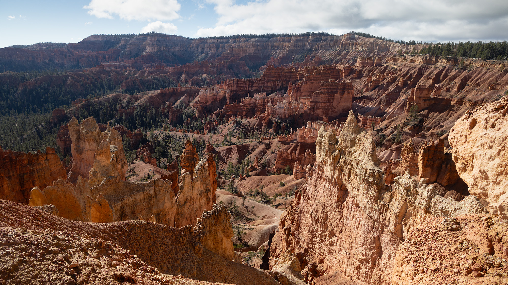

# AI-Assisted Landscape Editing Benchmark: Claude vs. Gemini (`_52_0265`)

**Date:** November 16, 2026  
**Source File:** `_52_0265.CR3` (Canon EOS R5, 45 MP, 16-bit ProPhoto RGB Smart Object)  
**Working Crop:** `8192 × 4608 px` (Non-destructive `16:9` crop: `left: 0, top: 205, right: 8192, bottom: 4813`)  
**MCP Architecture:** `mikechambers/adb-mcp` (`ps-mcp.py` + `ps-batch-play.py` over `ws://localhost:3001` UXP bridge)

---

## 1. Visual Side-by-Side Comparison

> *Place the three 2000 px sRGB reference JPEGs inside `./comparison/` to render inline.*

### Original Baseline (16:9 Cropped, WB-Only)

### Claude Final Edit (2 Passes — Milder, Center-Guiding)

### Gemini Final Edit (1 Pass — Higher Global & Bowl Contrast)

---

## 2. Executive Summary & Visual Verdict

* **Winner for Visual Storytelling:** **Claude (`_52_0265-Edit.tif`)**
* **Why Claude Looked Better:**
  * **Visual Funneling Over Heavy Lifting:** Instead of aggressively lifting the center, Claude calmed the bright, high-texture lower-right boulder and rubble (`−5.3` to `−6.4 L*` plus subtle Texture/Clarity reduction) while giving the central hero spire crisp micro-contrast (`+11%` detail) and a restrained `+2.5 L*` lift. This naturally guides the viewer's eye into the center of the amphitheater.
  * **Aerial Perspective Preserved:** Claude left the distant plateau rim completely untouched (`0.0 ΔL*`), maintaining natural front-to-back atmospheric depth.
  * **Localized Shadow Color Correction:** Claude caught a cold blue skylight cast (`b* = −12.35`) in the deep forest shadows (`L* 10–20`) and warmed only the darks (`b* −9.4 → −4.8`) without shifting sunlit foliage (`105° → 104°`).
* **How Gemini Behaved Differently:**
  * **Punchier Global Sculpting:** Gemini treated the image like a contrast-and-histogram optimization problem—lifting the shaded amphitheater bowl by `+3.96 L*`, pulling the overcast sky down by `−6.06 L*`, and dehazing the distant plateau rim (`−2.46 L*`, `+8.7%` detail). While technically clean with zero crevice clipping, the broader contrast lifts pull the eye in multiple directions at once.

---

## 3. Step-by-Step Workflow Comparison

| Phase | Claude (`_52_0265-Edit.tif`) | Gemini (`_52_0265-Edit-gemini.tif`) |
| :--- | :--- | :--- |
| **Step 1: White Balance (`wb.py`)** | Confirmed neutral clouds (`b* −1.12`) & red rock (`58°` hue). Flagged faint green tilt (`a* −1.3`) and isolated **deep forest blue shadow cast (`b* −12.35`)**. | Confirmed neutral clouds (`b* −0.78`) & red rock (`57.1°` hue, matching `0028` benchmark). Grouped all pines together (`b* −4.99`) as natural skylight. |
| **Step 2: Crop & Framing** | Recommended **16:9 crop (`top: 205, bottom: 4813`)** to cut bottom-right rubble (`33%` visual weight) and place the hero spire on the right-third line. | Recommended Native 3:2 primary, with 16:9 option (`top: 500, bottom: 5108`), noting top trims `>700 px` slice the right horizon. |
| **Step 3: Critique Philosophy** | **Subject isolation & edge suppression:** Calm loud foreground rubble, crisp up the hero spire, warm blue forest darks, and preserve far haze. | **Bowl opening & rim definition:** Treat right sunlit fin as entry anchor, lift shaded amphitheater bowl, model clouds, and etch distant plateau rim. |
| **Step 4: Masking Strategy** | 6 targeted masks (`F1`–`T3`): tight radial on hero spire, broad calm on BR rubble, linear calm on BL rubble, darks-only forest warm-up, gentle middle lift, subtle cloud pull. | 4 broad masks: wide bowl radial (`Feather 75`), sky highlight gradient, horizontal distant rim oval, narrow right-edge linear gradient. |
| **Step 5–6: Iteration & Visual Proof** | Executed Pass 1, measured calibration gaps (`LocalTemperature` = `0.025 b*` per `0.01`), ran calibrated Pass 2, and generated inline proof crops (`diffmap`, `dbmap`, `spire_zoom`, `before_after`). | Executed single pass with clean crevice isolation (`0.00 ΔL*`), saving measurement PNGs to `./recipes/measure/`. |

---

## 4. Quantitative Regional Comparison

### Claude Pass 2 Final Metrics (`16:9` Crop, `2000 px` Render)

| Region | `L*` (Base → Pass 1 → Pass 2) | `C*` (Base → Pass 2) | Detail Change | Visual Weight (Base → Pass 2) |
| :--- | :--- | :--- | :--- | :--- |
| **Sky / clouds (`T3`)** | `94.1 → 91.6 → 91.6` | `2.7 → 3.1` | `0%` | `1.6% → 1.9%` |
| **Far rim** | `35.4 → 35.4 → 35.4` | `11.7 → 11.8` | `−1%` | `3.8% → 4.0%` |
| **Forest, left (`F3`)** | `20.4 → 21.0 → 21.2` | `9.6 → 7.9` | `−7%` | `1.3% → 1.1%` |
| **Middle amphitheater (`T1`)** | `21.8 → 24.6 → 24.7` | `12.4 → 14.1` | `+1%` | `5.0% → 5.6%` |
| **Hero spire (`F2`)** | `49.2 → 51.6 → 51.9` | `25.8 → 25.4` | `+11%` | `7.4% → 9.0%` |
| **Right boulder (`F1`)** | `75.2 → 68.9 → 69.0` | `27.0 → 26.2` | `−5%` | `11.7% → 10.6%` |
| **Bottom-right rubble (`F1`)** | `66.4 → 61.1 → 61.0` | `34.8 → 32.4` | `−6%` | `21.3% → 19.0%` |
| **Bottom-left rubble (`T2`)** | `24.6 → 23.0 → 23.0` | `26.7 → 25.1` | `−3%` | `16.2% → 16.0%` |
| **Gully** | `46.9 → 45.7 → 45.7` | `24.2 → 23.3` | `−1%` | `2.0% → 2.1%` |

### Gemini Pass 1 Metrics (`16:9` Crop, `2000 px` Render)

| Region | Base `L*` | Pass 1 `L*` | `ΔL*` | Base Det | Pass 1 Det | Detail Change | `ΔC*` |
| :--- | :--- | :--- | :--- | :--- | :--- | :--- | :--- |
| **Sky Top Band** | `94.2` | `88.2` | `−6.06` | `0.34` | `0.42` | `+22.2%` | `+0.87` |
| **Central Bowl (Rock)** | `32.3` | `38.7` | `+3.96` | `4.75` | `5.41` | `+13.8%` | `+1.63` |
| **Central Crevices** | `12.4` | `12.4` | `−0.00` | `3.39` | `4.42` | `+30.1%` | `+0.01` |
| **Distant Plateau Rim** | `34.6` | `32.0` | `−2.46` | `2.63` | `2.86` | `+8.7%` | `+0.45` |
| **Right Edge Strip** | `77.3` | `72.9` | `−4.37` | `6.15` | `6.15` | `+0.1%` | `+0.09` |
| **Sunlit Fin (Hero)** | `74.9` | `73.8` | `−0.00` | `7.60` | `7.59` | `−0.1%` | `+0.01` |
| **Deep Gorge Floor** | `11.0` | `11.0` | `−0.00` | `3.73` | `4.39` | `+17.6%` | `+0.00` |

---

## 5. Key Takeaways Added to Shared Recipe Library (`GEMINI.md` / `ps-acr-recipes.md`)

1. **Guide the Eye via Edge Restraint:** Calm bright/textured foreground corners (`Exposure −0.06` to `−0.08` stored, `Texture −0.10` to `−0.15`) rather than over-lifting the hero subject.
2. **Protect Aerial Depth:** Never dehaze or apply Clarity to the distant background rim (`0.0 ΔL*` target on far ridges).
3. **Neutralize Blue Shade Locally:** Use a dark-tones Luminance Range mask (`0 0 0.14 0.24`) with `LocalTemperature` (`~0.025 b*` shift per `0.01` stored unit) to remove blue skylight casts from shaded forest without warming sunlit foliage.
4. **Always Generate Visual Proof Overlays:** Produce `before_after`, `|ΔL*|×15` (`diffmap`), `Δb*` (`dbmap`), and `1:1` hero crops on every pass so spatial mask placement and micro-texture can be verified visually.
